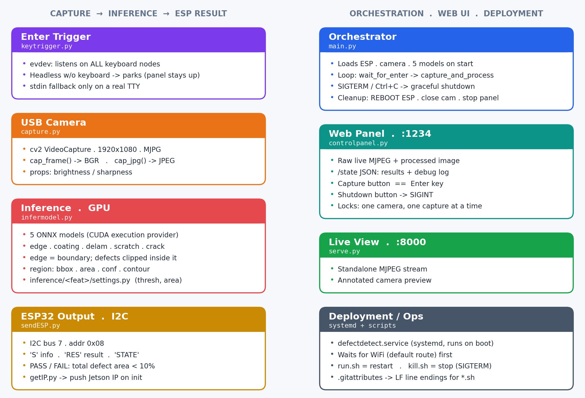

# JetVisionModel

Lab tool for inspecting lithium-ion battery electrodes for defects **before coin-cell assembly**, running on a **Jetson Orin Nano Super**.
A USB camera captures the electrode, five U-Net segmentation models (ONNX, CUDA) find defects, and the
result is shown on an **ESP32-C3 + ST7796 display** over I2C and on a **web control panel**.

Run U-net for jetson orin nano super for image ML
```
CAMERA CAPCTURE -> Jetson -> ESP for disp
                          -> Server for debug
```

## Quick commands

```bash
# 1. Stop the running app (pick one)
#    - web panel: http://<jetson-ip>:1234 -> "Shutdown" button   (no login needed)
#    - or after logging in:  ./kill.sh

# 2. Log in (IP is shown on the ESP display)
ssh steven@<jetson-ip>            # Wi-Fi / LAN
ssh steven@192.168.55.1           # USB-C cable
cd ~/workspace/JetVisionModel

# 3. Run
./run.sh                          # as the systemd service (stops any old instance first)
journalctl -u defectdetect -f     #   ...follow its logs
# or by hand, to see output in this terminal:
./kill.sh && source .venv/bin/activate && python main.py
```

Read more at: [Logging in to the Jetson](#logging-in-to-the-jetson) ·
[Running](#running) · [systemctl service](#systemctl-service-auto-start-on-boot) ·
[Troubleshooting](#troubleshooting)

---



```
USB camera ──> Jetson (capture -> 5x ONNX models -> summary)
                 ├── I2C ──> ESP32-C3 display  (IP, status log, results, PASS/FAIL)
                 └── HTTP ─> Web control panel  http://<jetson-ip>:1234
Trigger: "Enter" on the Jetson's own keyboard, or the "Capture & Process" button on the panel
```

---

## How it works

1. **Capture** (`capture.py`) – 1920×1080 MJPG frame from `/dev/video0`, manual exposure/gain, auto white balance.
2. **Inference** (`infermodel.py`) – frame → grayscale → 512×512 → normalised (mean 0.485, std 0.229) →
   all 5 models run on `CUDAExecutionProvider` (CPU fallback). Sigmoid is baked into the ONNX graphs.
3. **Post-processing** – each probability map is resized back to the frame, thresholded, and contoured.
   - `edge` runs first; only the **largest** edge contour is kept as the electrode boundary.
   - Every other defect is **clipped to inside that boundary**. No edge → no defects reported.
   - Regions below `MIN_AREA` are dropped. Confidence = mean probability over the region's pixels.
4. **Summary** – defect area of each type as a % of the electrode area.
   **PASS** if total defect area < **10 %**, otherwise **FAIL**.
5. **Output** – summary sent to the ESP32 (`sendESP.py`) and shown on the web panel (`controlpanel.py`).

### Models (`inference/<feature>/model.onnx`)

| Feature   | Meaning              | Threshold | Min area (px) | Colour    |
|-----------|----------------------|-----------|---------------|-----------|
| `edge`    | electrode boundary   | 0.9       | 1000          | `#EF476F` |
| `coating` | coating defect       | 0.8       | 1200          | `#06D6A0` |
| `delam`   | delamination         | 0.9       | 10            | `#118AB2` |
| `scratch` | scratch              | 0.3       | 1000          | `#FFD166` |
| `crack`   | crack                | 1.0 *     | 800           | `#FF6B35` |

Values are the ones actually used, from `THRESH` / `MIN_AREA` in `infermodel.py`.
Each `inference/<feature>/settings.py` holds a reference copy – keep them in sync.
\* With threshold `1.0` and the test `prob > THRESH`, crack is effectively disabled (`settings.py` has 0.7).

> TensorRT EP is intentionally not used: it can't build the pooling layers in these UNet/ECNet graphs
> and falls back to CUDA anyway. Re-add it only after a TRT-friendly re-export.

---

## Repository layout

| Path | Purpose |
|------|---------|
| `main.py` | Entry point: init ESP → camera → models → web panel, then loop on Enter |
| `capture.py` | Camera setup (opens on import), `cap_frame()`, `cap_jpg()`, image-quality overlay. Run alone to save `capture.jpg` |
| `infermodel.py` | Loads the 5 ONNX sessions on import; `infer(image)` → list of regions. Run alone to test on `testdata/test1455.jpg` |
| `controlpanel.py` | Web control panel on port **1234**; `capture_and_process()` is shared by Enter and the web button |
| `sendESP.py` | I2C link to the ESP32 (`SMBus(7)`, addr `0x08`). Run alone to send a `hello N` counter |
| `keytrigger.py` | Waits for Enter on the Jetson's **physical** keyboard via evdev (works when started over SSH / systemd) |
| `getIP.py` | Finds the Jetson's LAN IP (shown on the ESP and panel) |
| `serve.py` | Standalone live camera stream on port **8000** – use for focusing/exposure, not with `main.py` |
| `defectdetect.service` | systemd unit (auto-start on boot, waits for Wi-Fi) |
| `run.sh` / `kill.sh` | Restart / gracefully stop the app (systemd or hand-started) |
| `ESPcode/` | **Main ESP32-C3 firmware** – I2C slave + ST7796 GUI |
| `ESPtestRecieve/` | ESP test: print received I2C messages to Serial |
| `ESP_screen_test/` | ESP test: display only |
| `inference/` | ONNX models + per-feature settings |
| `testdata/` | Sample electrode images |
| `Pinouts/`, `docs/` | Pinout references, architecture diagram |

---

## Hardware & wiring

### Jetson ↔ ESP32-C3 SuperMini (I2C, 100 kHz)

| Jetson 40-pin header | ESP32-C3 SuperMini |
|----------------------|--------------------|
| Pin 3 (I2C SDA, bus 7) | GPIO 8 (SDA) |
| Pin 5 (I2C SCL, bus 7) | GPIO 9 (SCL) |
| Pin 6 (GND) | GND |

ESP is an I2C **slave at `0x08`**. Check it's visible with `sudo i2cdetect -y -r 7`.

### ESP32-C3 ↔ ST7796 display (SPI, 480×320 landscape)

| Display | ESP32-C3 GPIO |
|---------|---------------|
| SCLK | 4 |
| MOSI (SDA) | 6 |
| DC / RS | 3 |
| CS | 7 |
| RST | 10 |

Firmware uses **LovyanGFX**. See `Pinouts/` for board pinouts.

### Camera

USB/UVC camera on `/dev/video0`. Settings at the top of `capture.py`:

```python
WIDTH, HEIGHT = 1920, 1080
EXPOSURE_US   = 1300000   # UK mains is 50 Hz -> use multiples of 10 ms to avoid flicker
GAIN          = 1
AUTO          = False     # True = leave exposure on auto
```

List devices / check real driver values: `v4l2-ctl --list-devices`, `v4l2-ctl -d /dev/video0 --all`.

---

## I2C protocol (Jetson → ESP)

Every message is `b'S' + payload` (sent by `sendESP.send_info`). The ESP routes by payload prefix:

| Payload | Example | ESP action |
|---------|---------|------------|
| `IP<addr>` | `IP172.26.136.239` | Show Jetson IP (bottom-right) |
| `RES<summary>` | `RESEDGEarea:152340px crack:0.00% delam:0.12% scratch:0.00% coating:1.05%` | Results panel (one token per line) |
| `STATE<PASS\|FAIL>` | `STATEPASS` | Green PASS / red FAIL box |
| `REBOOT` | `REBOOT` | `ESP.restart()` – sent on shutdown |
| anything else | `Models Loaded` | Current status line; previous one moves to the log |

---

## Logging in to the Jetson

The Jetson runs **Ubuntu 22.04 (JetPack 6.2)**. User: `steven`, repo at `~/workspace/JetVisionModel`.
The password is kept in `ssh.secret` in the local repo contact Derek Siu or Zhengkun Sun (Mechanical Engineering) for Password.

### Ubuntu desktop (direct)

Plug a monitor (DisplayPort), USB keyboard and mouse into the Jetson, power on, and log in as `steven`
on the Ubuntu login screen. Open a terminal with **Ctrl+Alt+T**.

Get its IP for SSH:

```bash
hostname -I            # or: ip -4 addr show wlan0
```

The IP is also shown on the ESP display (bottom-right) once `main.py` / the service is running.

### SSH over Wi-Fi / LAN

Laptop and Jetson must be on the same network.

```bash
ssh steven@<jetson-ip>                 # e.g. ssh steven@172.26.136.239
```

### SSH over USB-C (no network needed)

Connect the laptop to the Jetson's USB-C port. JetPack exposes a USB network interface and the Jetson
is always at `192.168.55.1`:

```bash
ssh steven@192.168.55.1
```

### Optional: key login (no password each time)

```bash
# on the laptop
ssh-keygen -t ed25519                  # once, if you don't have a key yet
ssh-copy-id steven@<jetson-ip>         # Windows: type $env:USERPROFILE\.ssh\id_ed25519.pub | ssh steven@<jetson-ip> "cat >> ~/.ssh/authorized_keys"
```

Optional `~/.ssh/config` entry on the laptop, then just `ssh jetson`:

```
Host jetson
    HostName <jetson-ip>
    User steven
```

### VS Code

Install the **Remote - SSH** extension → *Remote-SSH: Connect to Host…* → `steven@<jetson-ip>` (or `jetson`)
→ open `~/workspace/JetVisionModel`.

### Checking the Jetson SSH server

```bash
sudo systemctl status ssh              # on the Jetson; install with: sudo apt install openssh-server
```

---

## Setup (Jetson)

Tested on **JetPack 6.2 (L4T 36.x)**, Python 3.10:

| Component | Version |
|-----------|---------|
| CUDA | 12.6 (`/usr/local/cuda/bin/nvcc --version`) |
| cuDNN | 9.3.0 (`grep CUDNN_MAJOR -A 2 /usr/include/cudnn_version.h`) |
| TensorRT | 10.3.0 (`grep NV_TENSORRT /usr/include/aarch64-linux-gnu/NvInferVersion.h`) |
| onnxruntime-gpu | 1.24.0 |

```bash
cd ~/workspace/JetVisionModel

# New venv with system packages (so JetPack's cv2 etc. are visible)
python3 -m venv --system-site-packages .venv

# activate venv
source .venv/bin/activate

# deactivate venv
deactivate

# install packages (apt: no aarch64 pip wheels for these)
sudo apt update
sudo apt install python3-opencv
sudo apt install -y python3-spidev
sudo apt install python3-evdev
sudo apt install -y i2c-tools

# python packages (onnxruntime-gpu comes from the Jetson AI Lab index in requirements.txt)
pip install -r requirements.txt

# permissions for keyboard / I2C / camera, then log out and back in
sudo usermod -aG input,i2c,video $USER
```

### Check CUDA, CuDNN, TensorRT version and ONNX ver

```bash
/usr/local/cuda/bin/nvcc --version
    # -> Cuda compilation tools, release 12.6, V12.6.68

cat /usr/include/cudnn_version.h | grep CUDNN_MAJOR -A 2
    # -> CuDNN Version: 9.3.0

cat /usr/include/aarch64-linux-gnu/NvInferVersion.h | grep NV_TENSORRT
    # -> TensorRT Version: 10.3.0

python3 -c "import onnxruntime as ort; print(ort.__version__, ort.get_available_providers())"
    # -> 1.24.0 ['TensorrtExecutionProvider', 'CUDAExecutionProvider', 'CPUExecutionProvider']
```

### download ONNX:

- https://onnxruntime.ai/docs/execution-providers/CUDA-ExecutionProvider.html#requirements
- https://pypi.jetson-ai-lab.io/jp6
  -> Jetpack uses aarch64 so download any version compatible with cuda126, NOW it is 1.24.0

### Enable GPIO

```bash
sudo /opt/nvidia/jetson-io/jetson-io.py --show
    # Configure 40-pin header -> enable spi1

# if this does not work, check DTB file:
sudo mkdir -p /boot/dtb
sudo rm -rf /boot/dtb/*
sudo ln -snf /boot/tegra234-p3768-0000+p3767-0005-nv.dtb /boot/dtb/kernel_tegra234-p3768-0000+p3767-0005-nv.dtb
NPATH=/opt/nvidia/jetson-io:$PYTHONPATH TERM=vt100 /opt/nvidia/jetson-io/jetson-io.py

sudo reboot
```

#### I2C (ESP link)

Header pins 3 (SDA) / 5 (SCL) are already I2C by default on the Orin Nano – this is **bus 7**
(`/dev/i2c-7`), which `sendESP.py` uses. jetson-io has no I2C option for them, so nothing to enable;
just give the user access and check the ESP shows up:

```bash
sudo apt install -y i2c-tools
sudo usermod -aG i2c $USER        # then log out / in
ls /dev/i2c-*                     # /dev/i2c-7 should exist
sudo i2cdetect -y -r 7            # ESP should appear at 0x08
```

`numpy` is pinned `<2` so JetPack's cv2/torch don't break. onnxruntime-gpu is left unpinned because the
index (https://pypi.jetson-ai-lab.io/jp6) prunes old builds – take whatever cu126 build is there.
Reference: https://onnxruntime.ai/docs/execution-providers/CUDA-ExecutionProvider.html#requirements

### ESP32 firmware

Open `ESPcode/ESPcode.ino` in Arduino IDE, board **ESP32C3 Dev Module** (SuperMini), install the
**LovyanGFX** library, and upload.

---

## Running

### By hand

```bash
source .venv/bin/activate
python main.py
```

- Press **Enter** on the Jetson's keyboard (or click **Capture & Process** on the panel) to capture → infer → send.
- **Ctrl+C**, `./kill.sh`, or the panel's **Shutdown** button exits gracefully
  (sends `REBOOT` to the ESP, releases the camera, stops the panel).

### Component tests

```bash
python capture.py          # save one frame to capture.jpg
python infermodel.py       # run models on testdata/test1455.jpg -> testdata/test1455_results.jpg
python sendESP.py          # send "hello N" to the ESP every second
python keytrigger.py       # list keyboards and wait for Enter  (add `debug` to print every key)
python serve.py            # live stream at http://<jetson-ip>:8000  (don't run with main.py – one camera)
```

### Web control panel – `http://<jetson-ip>:1234`

Live raw image, last processed image (defect outlines), results (edge area, per-defect %, PASS/FAIL,
per-region table), debug log with brightness/sharpness, Capture and Shutdown buttons.

| Endpoint | Method | |
|----------|--------|-|
| `/` | GET | Panel page |
| `/raw` | GET | Live MJPEG stream (~10 fps) |
| `/processed.jpg` | GET | Last annotated result |
| `/state` | GET | JSON state (results + log) |
| `/capture` | POST | Same as pressing Enter |
| `/shutdown` | POST | Stop the app |

The Jetson IP is shown on the ESP display at boot.

### IP

at WPA: 172.26.136.239

---

## systemctl service: (auto-start on boot)

`defectdetect.service` assumes user `steven` and the repo at `/home/steven/workspace/JetVisionModel`
with a `.venv` inside – edit it if that differs. It waits up to ~60 s for Wi-Fi so the right IP is shown,
and restarts on failure (camera/I2C not ready yet).

```bash
sudo cp ~/workspace/JetVisionModel/defectdetect.service /etc/systemd/system/defectdetect.service
sudo systemctl daemon-reload
sudo systemctl enable defectdetect      # start automatically on every boot
sudo systemctl start defectdetect       # start it right now

journalctl -u defectdetect -f           # view cmd

sudo systemctl restart defectdetect
systemctl status defectdetect

./run.sh                                # stop anything running, then start the service
./kill.sh                               # graceful stop (service or hand-started main.py)

sudo systemctl stop defectdetect        # stop
sudo systemctl disable defectdetect     # stop running on boot
```

Headless with no keyboard plugged in, the app keeps the web panel running and starts listening
for Enter as soon as a keyboard appears.

---

## Troubleshooting

- **Camera not found** – `v4l2-ctl --list-devices`; make sure `serve.py` isn't holding the camera.
- **`[I2C Error] Bus 7, Addr 0x08`** – check wiring/GND, `sudo i2cdetect -y -r 7`, user in `i2c` group.
- **Enter does nothing** – user must be in `input` group (or run `python keytrigger.py debug`).
- **Service can't find CUDA libs** – uncomment `Environment=LD_LIBRARY_PATH=/usr/local/cuda/lib64` in the unit.
- **Service can't reach keyboard / camera / I2C** – uncomment `SupplementaryGroups=...` in the unit.
- **Need the 40-pin header reconfigured** (e.g. SPI) – see [Enable GPIO](#enable-gpio).
